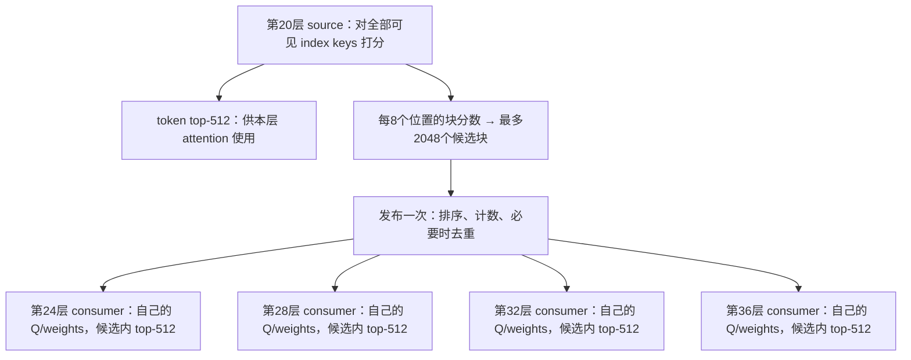

# 优化前后的机制

本页解释实际实现与实验范围；数字索引见[性能汇总](PERFORMANCE.md)。这里的 Indexer 是为稀疏注意力挑位置的模块，它输出逻辑位置，随后真正的 attention 再读取被选中的 KV 做注意力计算。Indexer 的 FP8 key cache 用于检索打分，不能与 attention 的完整 KV cache 混称。

## 输入、打分和位置空间

实验保留 FP8 E4M3 Q/K，单 key 的 FP32 scale，以及包含 Q scale 的 FP32 head weights。典型输入 Q 为 `[query_rows,32,128]`、weights 为 `[query_rows,32]`。概念公式为：

```text
score(q, t) = sum_h weight(q,h) * ReLU(dot(Q_fp8[q,h,:], K_fp8[t,:]) * K_scale[t])
```

实现保留原路径的 scale、ReLU 和 FP32 归约语义；点积的具体累加舍入由所用 FP8 kernel 决定，不能凭概念公式宣称 FP32 oracle 逐元素完全相等。每个 query 独立屏蔽不可见位置，selector 在合法位置中选最多 512 项，不足填 -1，输出集合唯一，输出列表不承诺按分数排序。

页表把逻辑 index-key 位置映射到本 rank 的物理 cache 页。ratio=2 时 index-key 数不等于原 token 数；prefill 第 j 行可见数量为 `floor((prefix+j+1)/ratio)`。候选块大小 8 指 index-key 空间中的 8 个位置。模块不会替调用者把原 token 长度当成 index-key 长度。

## source＋4 consumer 到底是什么

source 是产生候选块的 Indexer 层；consumer 是使用这些候选块、再独立打分的后续 Indexer 层。当前模型形状使用 source 第 20 层、consumer 第 24/28/32/36 层；full ratio-2 层为 2/8/14。这里的编号沿实验模型配置，不表示这些层在模型里紧挨着。



source 同时做两件事：选本层所需的 token top-512；以每块最大 score 选出最多 2048 个块，按既有规则保留最新块，供后续四个 consumer 使用。后续层共享的是**候选范围**，并不直接复用 source 的 512 个最终位置，也不复用它的 score。四个 consumer 用不同 Q/head weights 在候选范围重新评估，各自得到自己的 top-512。

例如上下文有 262,144 个 index keys，source 仍需要完整扫描。它给出最多 2048×8=16,384 个候选位置。优化前，四个 consumer 各自对 262,144 个位置打分，再把候选外分数屏蔽；优化后，每个 consumer 只读取并打分候选位置。于是候选上限约为全长的 1/16，但整个模块加速不等于 16×，因为还有 source、发布、间接访问、top-k、准备及通信成本。

实验中的“完整链路”是：

```text
source 打分 + source token top-k + source block top-k
  + 候选发布一次
  + consumer 1 的打分/选择
  + consumer 2 的打分/选择
  + consumer 3 的打分/选择
  + consumer 4 的打分/选择
```

它不包含这些层真正的 attention、MoE、残差流或层间 hidden-state 演进。模块实验给四个 consumer 准备不同输入，重现选择计算与共享候选关系，不是完整模型前向。四个 consumer 也不是四张 GPU；单卡上可以测这条链，TP4 是另外的并行维度。

## P2：候选发布、compact scoring、融合映射

|环节|原对照机制|优化实现|
|---|---|---|
|候选规范化|各 consumer 重复整理，通用排序／去重|source 唯一候选采用一次排序计数；外部任意候选走去重路径|
|发布生命周期|同一组 consumer 重复准备|同一次组合调用发布一次，四个不同 Q/weights consumer 复用|
|score 范围|扫描全部 K，再 mask 非候选|直接按候选块查本地页表、读 FP8 K，仅计算有效候选|
|top-k 坐标|先返回紧凑 score 下标，再启动映射 kernel|在 top-k 中用逻辑块表把紧凑位置直接变为原逻辑 index-key 位置|

若紧凑位置是 `c`，候选块表为 `blocks`，映射为 `blocks[c//8]*8 + c%8`。尾块要按可见长度裁剪；空候选、非法块、重复块不能产生重复或未来位置。候选缓存只在本次组合中有效，没有跨 step 的隐式全局复用。

短上下文时，整理候选和间接访存可能比顺序全扫描更贵。P3 的短窗口组合保留 full-score＋mask consumer，不能把 compact 当成所有形状的默认答案。

## P3：full/source 和 source 选择

full/source 不能像 consumer 一样凭空跳过未选区域。实验实现了从 paged FP8 cache 直接读取的 Triton/Gluon full scorer、按可见 tile 限制工作、融合 block max，以及最大 1 GiB score arena 分块。但已测性能中新 full scorer 普遍不胜 DeepGEMM，保留主要性能路径为 DeepGEMM score。

source 的收益很大一部分来自 token/block selector 及候选发布组合，不能都归因于新 score kernel。保留 source 的两个输出，不能省去 token top-k 后宣称同等工作更快。大 cache 页地址乘法改用 int64，修复大于 2 GiB 的字节偏移溢出。

混合空请求暴露了已安装 DeepGEMM producer 预取错误：调度跳过空请求，预取却固定取下一行。隔离补丁改为找下一有效调度项。补丁只在显式实验包中加载，全局依赖未覆盖；稳定 full/chain 的复现需要匹配该依赖。

## P4：verify 中共享 key tile

同一请求的多个 verify query 会访问同一段 K。逐行执行会重复读取相同 key tile。grouped kernel 将同请求 1/2/4/6/8 行组织在一起，读一次 tile，为多个 Q 分别计算，再独立应用每行可见长度。

consumer 只有在候选块布局满足共同前缀等共享合同的时候才共享 K；不同候选集合仍逐行，不构造昂贵并集。候选资格检查如果每步搬到 host 重规划，实测可达 0.38–17.6 ms，超过 GPU 节省，所以该前提必须显式写入合同和计时范围。N6/N8 的部分原生对照是展开单行调用，报告明确标注，不能当原生融合 kernel。

## P5/P5b/P5c：三种不同的 prefill 研究

|阶段|实现内容|覆盖边界|
|---|---|---|
|原 P5|DeepGEMM、row-tiled、既有 keys-major、grouped-Gluon 对照|早期 consumer 有 request-shared 候选限制；`gluon` 调的是 grouped decode/verify scorer|
|P5b 专用 Ant|32 query 行的全部 heads 驻共享内存；Q/K TMA、三级 K 缓冲、跨 head 双缓冲异步 WGMMA、按可见 tile 常驻调度|真正迁移专用 prefill 文件；FP8 scale/weights 语义不变；consumer 对照是 full-score＋逐query mask|
|P5c 逐query compact|每行自己的 `[Q,2048]` 候选；direct 间接读 K 与 gathered WGMMA 两条路径|覆盖真实逐query consumer，分块控制 score≤1 GiB、gather≤256 MiB；准备与全部 chunk 计时|

P5b 没有搬 FP4 解包，没有照搬 Ant 的 BF16 舍入点，也不假设 FP4 的精确点积累加性质适用于任意 FP8。D128 原生累加适配对照已完成，未发现稳定 >5% 新收益；4×D32 只做数值诊断，不能据此排除所有 Ant 变体。

P5c 的 gathered 路径是先聚集候选 K，再使用**自定义 FP8 WGMMA**，不能称作 DeepGEMM。已测 direct 更快。短 prefill 保留全量路径；长上下文收益明显。不会直接套用 Ant 的 2M score 阈值，调度只准入有实证的精确合同。

## P6：确定性 top-k

在同一份 FP32 logits 上，边界同分固定保留较小逻辑位置。compact 使用寄存器路径，full/source 研究 streaming、cluster、长行 plan。H20 的 SM 数用于计算 cluster pool，不照搬 H200 默认值。输出选集稳定不等于按分数排好顺序。

预规划和每次重新规划分别测量。部分大 batch 长行 cluster 很慢，不能统一启用。若业务明确要求确定性，不得为了速度回退到同分不确定的 selector 并声称语义不变。

## P7/P8：四卡行分摊与显式选路

复制模式四卡拥有完整 index heads 和逻辑 cache，独立置换物理页，计算相同 query。行分摊按请求组分配 query，尽量保持 verify 组完整，各 rank 只计算归属行，再 all-gather 逻辑 top-k 位置、恢复原行序。物理页号不跨 rank 传输。

输入已复制时计入本地行整理；输入仅在 root 时另计 scatter。source 和四个 consumer 共用行所有权，候选在所有者本地发布。不是把 32 heads 切成每卡 8 heads，也没有实现 PCP/DCP cache 分片。

P8 规划器检查精确形状、分组、候选布局、执行模式、运行依赖和通信模式。旧 P8 有 400 条候选比较准入／204 条拒绝；P5c 另有 16 个精确合同。数量不是不同 kernel 数。未知形状回退，长度或结构合同改变需重新规划。收益不足 5% 或不高于噪声的实验保留记录但不自动选择。
